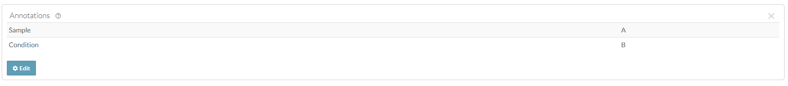

## Overview

Annotations help users search for and find data, and they are a powerful
tool used to systematically group and/or describe things in Synapse.

Annotations are stored as key-value pairs in Synapse, where the key defines
a particular aspect of your data, for example (`species`, `assay`,
`fileFormat`) and the value defines a variable that belongs to that category
(`mouse`, `RNAseq`, `.bam`). You can use annotations to add additional
information about a project, file, folder, table, or view.

Annotations can be based on an existing ontology or controlled vocabulary,
or can be created as needed and modified later as your metadata evolves.

**Note:** You may optionally follow the
[Uploading data in bulk](upload_data_in_bulk.html) tutorial instead. The
bulk tutorial may fit your needs better as it limits the amount of code
that you are required to write and maintain.

In this tutorial you will:

1. Add several annotations to stored files
1. Upload 2 new files and set the annotations at the same time

## Prerequisites

* Make sure that you have completed the [Files](file.html) vignette or have
  at least 1 file in your Synapse project.

## 1. Add several annotations to stored files

### First let's retrieve all of the Synapse IDs we are going to use

```{r collapse=TRUE, eval=FALSE}
library(synapser)
synLogin()

# Retrieve the project ID
my_project_id <- (
  Project(name = "My uniquely named project about Alzheimer's Disease") |> synGet()
)$id

# Retrieve the folders I want to annotate files in
batch_1_folder <- Folder(
  name = "single_cell_RNAseq_batch_1",
  parent_id = my_project_id
) |> synGet()

cat("Batch 1 Folder ID:", batch_1_folder$id, "\n")
```

### Next let's define the annotations I want to set

```{r collapse=TRUE, eval=FALSE}
# Define the annotations I want to set
annotation_values <- list(
  species = "Homo sapiens",
  dataType = "geneExpression",
  assay = "SCRNA-seq",
  fileFormat = "fastq"
)
```

### Finally we'll loop over all of the files and set their annotations

`synSyncFromSynapse()` with `download_file = FALSE` fills in the folder's
`files` field without downloading any file content.

```{r collapse=TRUE, eval=FALSE}
batch_1_folder <- batch_1_folder |> synSyncFromSynapse(download_file = FALSE)

# Loop over all of the files and set their annotations
for (file_batch_1 in batch_1_folder$files) {
  # Grab and print the existing annotations this File may already have
  existing_annotations_for_file <- file_batch_1$annotations

  cat(
    "Got the annotations for File:", paste0(file_batch_1$name, ","),
    "ID:", paste0(file_batch_1$id, ","),
    "Annotations:", rjson::toJSON(existing_annotations_for_file), "\n"
  )

  # Merge the new annotations with anything existing
  existing_annotations_for_file <- modifyList(
    existing_annotations_for_file, annotation_values
  )

  file_batch_1 <- file_batch_1 |>
    synSetProperties(annotations = existing_annotations_for_file) |>
    synStore()
  cat(
    "Set the annotations for File:", paste0(file_batch_1$name, ","),
    "ID:", paste0(file_batch_1$id, ","),
    "Annotations:", rjson::toJSON(existing_annotations_for_file), "\n"
  )
}
```

<details class="example">
  <summary>You'll see that each file now has a number of annotations:</summary>

```
Batch 1 Folder ID: syn53205629
Got the annotations for File: SRR12345678_R1.fastq.gz, ID: syn53205687, Annotations: {}
Set the annotations for File: SRR12345678_R1.fastq.gz, ID: syn53205687, Annotations: {'assay': ['SCRNA-seq'], 'species': ['Homo sapiens'], 'dataType': ['geneExpression'], 'fileFormat': ['fastq']}
Got the annotations for File: SRR12345678_R2.fastq.gz, ID: syn53205688, Annotations: {}
Set the annotations for File: SRR12345678_R2.fastq.gz, ID: syn53205688, Annotations: {'assay': ['SCRNA-seq'], 'species': ['Homo sapiens'], 'dataType': ['geneExpression'], 'fileFormat': ['fastq']}
```
</details>

## 2. Upload 2 new files and set the annotations at the same time

Assuming we have a few new files we want to upload we'll follow a similar
pattern defined in the [Files](file.html) vignette, except now we'll
specify the `annotations` attribute before uploading the file to Synapse.

In order for the following script to work please replace the files with
ones that already exist on your local machine.

```{r collapse=TRUE, eval=FALSE}
batch_1_scrnaseq_new_file_1 <- File(
  path = path.expand("~/my_ad_project/single_cell_RNAseq_batch_1/SRR92345678_R1.fastq.gz"),
  parent_id = batch_1_folder$id,
  annotations = annotation_values
) |> synStore()

batch_1_scrnaseq_new_file_2 <- File(
  path = path.expand("~/my_ad_project/single_cell_RNAseq_batch_1/SRR92345678_R2.fastq.gz"),
  parent_id = batch_1_folder$id,
  annotations = annotation_values
) |> synStore()

cat(
  "Stored file:", paste0(batch_1_scrnaseq_new_file_1$name, ","),
  "ID:", paste0(batch_1_scrnaseq_new_file_1$id, ","),
  "Annotations:", rjson::toJSON(batch_1_scrnaseq_new_file_1$annotations, indent = 2), "\n"
)
cat(
  "Stored file:", paste0(batch_1_scrnaseq_new_file_2$name, ","),
  "ID:", paste0(batch_1_scrnaseq_new_file_2$id, ","),
  "Annotations:", rjson::toJSON(batch_1_scrnaseq_new_file_2$annotations, indent = 2), "\n"
)
```

<details class="example">
  <summary>You'll notice the output looks like:</summary>

```
Stored file: SRR92345678_R1.fastq.gz, ID: syn53206218, Annotations: {
  "assay": [
    "SCRNA-seq"
  ],
  "dataType": [
    "geneExpression"
  ],
  "fileFormat": [
    "fastq"
  ],
  "species": [
    "Homo sapiens"
  ]
}
Stored file: SRR92345678_R2.fastq.gz, ID: syn53206219, Annotations: {
  "assay": [
    "SCRNA-seq"
  ],
  "dataType": [
    "geneExpression"
  ],
  "fileFormat": [
    "fastq"
  ],
  "species": [
    "Homo sapiens"
  ]
}
```
</details>

## Results

Now that you have annotated your files you'll be able to inspect this on
the individual files in the Synapse web UI. It should look similar to:



## References used in this tutorial

- [`File`](../reference/File.html)
- [`Folder`](../reference/Folder.html)
- [`Project`](../reference/Project.html)
- [`synGet()`](../reference/synGet.html)
- [`synStore()`](../reference/synStore.html)
- [`synSetProperties()`](../reference/synSetProperties.html)
- [`synSyncFromSynapse()`](../reference/Folder_SyncFromSynapse.html)
