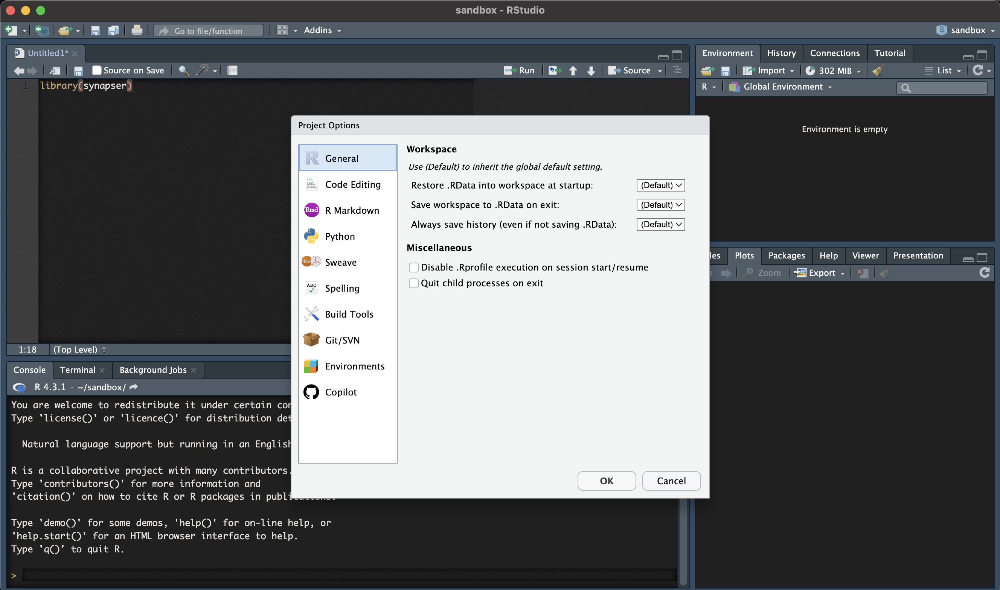
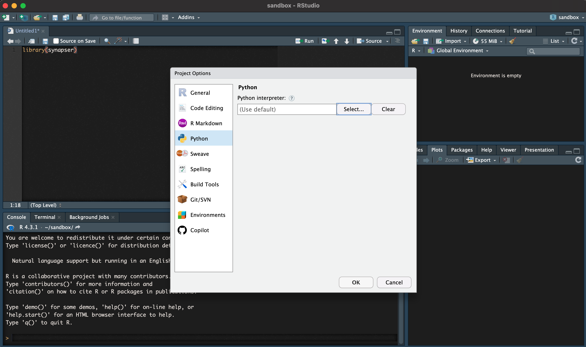
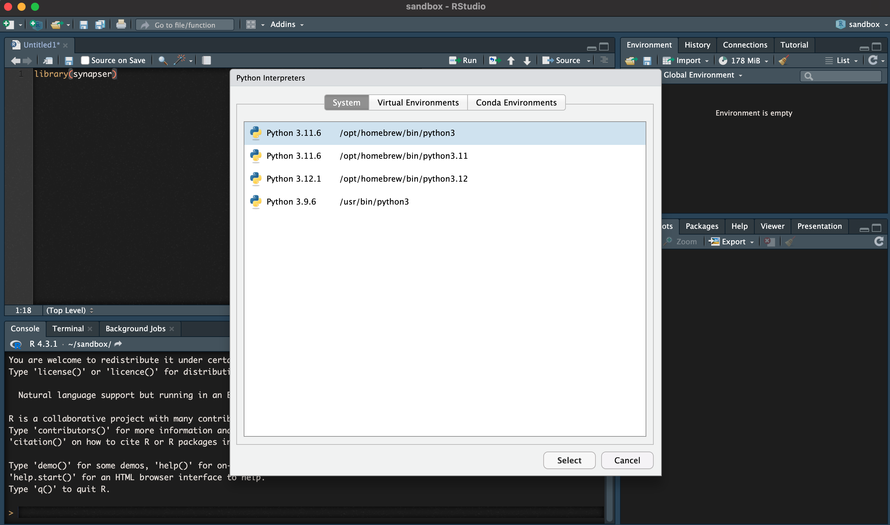
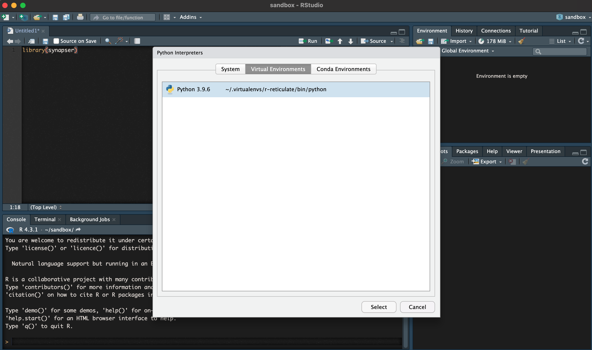
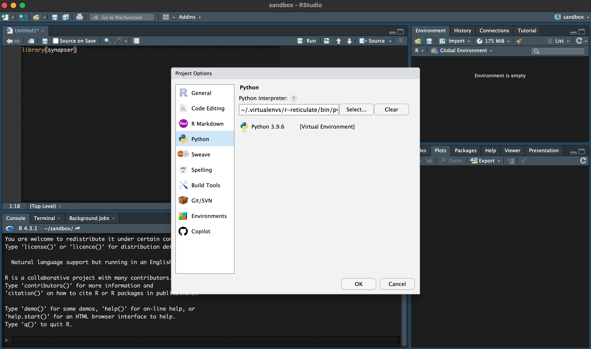

synapser is a wrapper around the Synapse Python client (`synapseclient`). This guide covers installing synapser 3.0.0 on Windows, macOS, and Linux.

synapser 3.0.0 is distributed through [R-universe](https://sage-bionetworks.r-universe.dev) at `https://sage-bionetworks.r-universe.dev/synapser`. Releases of synapser 2.x and earlier remain on the Synapse R repository (RAN) at `http://ran.synapse.org`; see [Installing an older version](#installing-an-older-version).

## Prerequisites

- R 4.2.0 or later (R 4.1.x is not supported: it is the last Windows R with 32-bit multiarch, and reticulate 1.44.0 or later does not build for 32-bit Windows).
- reticulate 1.44.0 or later (earlier versions are incompatible with uv 0.8.0 and later, and fail with `could not find a Python environment for /`). You do not need to install reticulate yourself. It is installed automatically as a dependency of synapser.
- Python 3.10 or later. You do not need to install Python yourself. If none is configured, synapser downloads a compatible one (Python 3.10 to 3.14). If reticulate is already pointed at a Python, that installation must be 3.10 to 3.14. See [How synapser finds Python](#how-synapser-finds-python).
- No other Python environment that reticulate will pick up ahead of its managed one, unless you want synapser to use it. A common example is a `.venv` folder in the directory R starts in, such as `~/.venv` when R starts in your home folder. When reticulate finds an environment like this, synapser installs the Synapse Python client into it with pip instead of using the managed environment. If that environment has no pip (environments created with `uv venv` do not have pip by default), `library(synapser)` fails. See [How synapser finds Python](#how-synapser-finds-python) for every location reticulate checks, and the [Troubleshooting](troubleshooting.html#virtual-environment-without-pip) vignette for the error you get and how to fix it.

Check your R version with:
```r
R.version.string
```

## Install R

| OS | Where to get R |
|----|----------------|
| Windows | [CRAN Windows installer](https://cran.r-project.org/bin/windows/base/) |
| macOS | [CRAN macOS installer](https://cran.r-project.org/bin/macosx/). Choose the build that matches your Mac: `arm64` for Apple silicon (M1 and later), `x86_64` for Intel. |
| Linux | Your distribution's instructions on [CRAN](https://cran.r-project.org/bin/linux/), e.g. Ubuntu, Debian, Fedora, or RHEL. |

Optionally, install [RStudio Desktop](https://posit.co/download/rstudio-desktop/).

## Install synapser

On Windows and macOS, run the command below. Listing CRAN alongside R-universe lets R pull synapser's dependencies (such as `reticulate` and `rjson`) from CRAN as ready-built packages.

On Linux, CRAN only provides source packages, and several of synapser's dependencies contain compiled code. **Complete the [Linux](#linux) steps first**, then run the same command.

```r
install.packages(
  "synapser",
  repos = c("https://sage-bionetworks.r-universe.dev", "https://cloud.r-project.org")
)
```

Or

```r
options(repos = c("https://sage-bionetworks.r-universe.dev", "https://cloud.r-project.org"))
install.packages("synapser")
```

The sections below cover the setup for each operating system. Linux needs extra steps; Windows and macOS do not.

### Windows

No extra setup is needed. R-universe provides synapser already built for Windows, so you do not need to install [Rtools](https://cran.r-project.org/bin/windows/Rtools/) (the toolkit Windows uses to build R packages from source code).

If you only use R through RStudio, you can skip the rest of this section. If you want to run `R` or `Rscript` from a terminal such as Command Prompt, PowerShell, or VS Code, Windows needs to know where R is installed. Add R's `bin` folder, e.g. `C:\Program Files\R\R-4.5.1\bin` (use your R version), to your `PATH` environment variable.

### macOS

- R-universe provides prebuilt binaries for both Apple silicon and Intel Macs, so you do not need Xcode command line tools.
- macOS ships a Python at `/usr/bin/python3`. You do not need it and synapser will not use it unless you point reticulate at it; the managed environment described below is preferred.

### Linux

R on Linux installs packages from source by default. synapser itself is pure R and needs no compiler, but most of its dependencies (including `reticulate`, `Rcpp`, `RcppTOML`, `rjson`, `jsonlite`, `rlang`, and `png`) contain C or C++ code that must be compiled. They all need a C/C++ compiler, and `png` also needs the libpng development headers.

Install them, then run the [standard command](#install-synapser). Many machines that already build R packages have both, in which case this step changes nothing. Without the libpng headers, installing `png` fails with `png.h: No such file or directory`.

Ubuntu / Debian (Optional):
```bash
sudo apt-get update
sudo apt-get install -y build-essential libpng-dev
```
If you installed R with `sudo apt install r-base`, you most likely already have both: apt also installs `r-base-dev`, which includes them. You need this step if R was installed with `--no-install-recommends` (as in CRAN's Ubuntu instructions), with [rig](https://github.com/r-lib/rig), or in a minimal Docker image. To check, run `dpkg -s build-essential libpng-dev`; it reports an error for any package that is missing.

Amazon Linux/RHEL/CentOS:
```bash
sudo dnf install -y gcc gcc-c++ make libpng-devel
```

## Verify the installation

Restart R, then load synapser:

```r
library(synapser)
packageVersion("synapser")  # should be 3.0.0
reticulate::py_config()     # shows which Python synapser is using
```

The first `library(synapser)` may take a minute while reticulate downloads Python and the Synapse Python client. Later loads reuse the cached environment.

Then log in. See the [Getting Started](synapser.html) vignette for authentication options:

```r
synLogin(authToken = "<your personal access token>")
```

## How synapser finds Python

When synapser is loaded, it declares its Python requirement (`synapseclient[pandas]`, pinned to the version synapser wraps) via `reticulate::py_require()`. If reticulate does not find another Python configured on your machine, it uses [uv](https://docs.astral.sh/uv/) to download a compatible Python and the Synapse Python client into a managed environment. This works the same way on Windows, macOS, and Linux. synapser supports Python 3.10 to 3.14 and does not request a specific one, so reticulate picks its own default: two minor versions behind the newest stable release (Python 3.12 as of reticulate 1.46.0).

By default, reticulate only uses this managed environment when no other Python takes precedence in its [Order of Discovery](https://rstudio.github.io/reticulate/articles/versions.html#order-of-discovery). In particular, synapser will use a different Python if any of the following apply:

- The `RETICULATE_PYTHON` or `RETICULATE_PYTHON_ENV` environment variable is set (this includes selecting a Python interpreter in RStudio's Project or Global Options).
- A Python virtual environment is activated (`VIRTUAL_ENV` is set), or your working directory contains a `.venv`, `venv`, or similar virtual environment.
- A virtual environment named `r-reticulate` exists (for example, `~/.virtualenvs/r-reticulate`, created by the installation instructions for synapser 2.x).

In those cases synapser installs the Synapse Python client into that Python, which must be version 3.10 to 3.14. To use the managed environment instead, remove the conflicting setting, e.g. `reticulate::virtualenv_remove("r-reticulate")`, and restart R.

## Upgrading from synapser 2.x

1. **Remove the `r-reticulate` virtual environment** that the 2.x instructions had you create, unless you deliberately want synapser to keep using it:
   ```r
   reticulate::virtualenv_remove("r-reticulate")
   ```

2. **Undo any `rjson` or `reticulate` pins.** synapser 3.0.0 works with current versions of both, and requires reticulate 1.44.0 or later; reticulate 1.28, which was pinned for 2.x, will break it:
   ```r
   install.packages(c("rjson", "reticulate"))
   packageVersion("reticulate")  # must be >= 1.44.0
   ```

3. **Switch your repository from RAN to R-universe.** If your `~/.Rprofile`, Dockerfile, or scripts list `http://ran.synapse.org`, replace it with `https://sage-bionetworks.r-universe.dev`. RAN does not host synapser 3.0.0.

4. **Install synapser** as described in [Install synapser](#install-synapser), then restart R.

## Installing an older version

R-universe serves only the latest release. Older releases (synapser 2.x and earlier, versioned `major.minor.patch.build`, e.g. `2.1.1.259`) are still on RAN:

```r
if (!require("remotes", quietly = TRUE)) {
  install.packages("remotes")
}

remotes::install_version(
  "synapser",
  version = "X.Y.Z.AAA",
  repos = c("http://ran.synapse.org", "https://cloud.r-project.org")
)
```

These versions have their own Python and dependency requirements; see the documentation for the release you are installing.

## Install from GitHub

The synapser source code is on GitHub at [Sage-Bionetworks/synapser](https://github.com/Sage-Bionetworks/synapser). Installing from GitHub is useful if you want to try changes that have not been released yet. For everyday use, install a released version from R-universe as shown above.

1. **Install the `remotes` package** if you don't already have it:
   ```r
   if (!require("remotes", quietly = TRUE)) {
     install.packages("remotes")
   }
   ```

2. **Install synapser from GitHub.** Without a `ref`, this installs the default branch, `develop`, which contains the latest development changes:
   ```r
   remotes::install_github("Sage-Bionetworks/synapser")
   ```

3. **Optionally, install a specific branch or release** by passing `ref`:
   ```r
   # The latest release
   remotes::install_github("Sage-Bionetworks/synapser", ref = "master")

   # A specific release, by its tag
   remotes::install_github("Sage-Bionetworks/synapser", ref = "3.0.0")
   ```

4. **Restart R, then load synapser** to confirm the installation:
   ```r
   library(synapser)
   packageVersion("synapser")
   ```

To install from a local clone of the repository instead, run `remotes::install_local(path = ".", upgrade = "never")` from its root directory.

On Linux, see the [Linux](#linux) section for how to get synapser's compiled dependencies.

## Troubleshooting

- **`ModuleNotFoundError: No module named 'synapseclient'`, or synapser is using the wrong Python.** Run `reticulate::py_config()` to see which Python is in use, then remove whatever is taking precedence (see [How synapser finds Python](#how-synapser-finds-python)) and restart R. In RStudio, check that Tools > Project Options (and Global Options) > Python does not select an interpreter you don't intend to use.
- **`library(synapser)` prints `Using virtual environment '<path>' ...` and then fails with `.onLoad failed in loadNamespace() for 'synapser'` and `the condition has length > 1`.** reticulate picked up an existing virtual environment at `<path>` that has no pip, so synapser could not install the Synapse Python client into it. See [the condition has length > 1](troubleshooting.html#virtual-environment-without-pip) in the Troubleshooting vignette for the fix.
- **`could not find a Python environment for /`.** Your reticulate is older than 1.44.0. Run `install.packages("reticulate")` and restart R.
- **`package 'synapser' is not available`.** Check that `https://sage-bionetworks.r-universe.dev` is in your `repos` and that your R is 4.2.0 or later.
- **A build of a dependency fails on Linux** with a compiler or missing header error (for example `png.h: No such file or directory`). Install the compiler and libpng headers as described under [Linux](#linux), then run the install again.
- **The install fails with an error mentioning `00LOCK-synapser`.** A previous install was interrupted and left a lock folder behind. Delete the `00LOCK-synapser` folder from your R package library (run `.libPaths()` to see where that is; on Windows it is typically `%LOCALAPPDATA%\R\win-library\4.5`), then install again.
- **The first load hangs or fails behind a proxy or firewall.** The managed environment downloads uv, Python, and Python packages from the internet. Either allow access to `astral.sh`, `github.com`, and `pypi.org`, or [use your own Python](#optional-use-your-own-python).

For more, see the [Troubleshooting](troubleshooting.html) vignette.

# (Optional) Use your own Python

Most users do **not** need this. Do it only if you want synapser to use a specific Python installation instead of the managed environment, for example to share an environment with other Python tools. The Python must be version 3.10 to 3.14.

## Point synapser at a Python

Set `RETICULATE_PYTHON` before loading synapser, either in `~/.Renviron` or at the top of your script:

```r
# Windows example
Sys.setenv(RETICULATE_PYTHON = "C:/Users/<you>/AppData/Local/Programs/Python/Python312/python.exe")
# macOS / Linux example
Sys.setenv(RETICULATE_PYTHON = "~/.pyenv/versions/3.12.8/bin/python")

library(synapser)
```

synapser installs the Synapse Python client into that Python on first load.

In RStudio, you can select the interpreter instead under Tools > Project Options (or Global Options) > Python:

{#id .class width=600 height=400px}

{#id .class width=600 height=400px}

Click Select, then choose the interpreter or virtual environment you want:

{#id .class width=600 height=400px}

{#id .class width=600 height=400px}

{#id .class width=600 height=400px}

## Installing Python

**Windows and macOS:** use an [official Python installer](https://www.python.org/downloads/), version 3.10 to 3.14. On Windows, check "Add python.exe to PATH" if you plan to run Python from a terminal. On macOS, do not use the Python that ships at `/usr/bin/python3`.

**macOS and Linux:** alternatively, use [pyenv](https://github.com/pyenv/pyenv?tab=readme-ov-file#installation) to manage multiple Python versions.

macOS:
```bash
brew install pyenv
```

Ubuntu / Debian:
```bash
sudo apt-get update
sudo apt-get install -y make build-essential libssl-dev zlib1g-dev \
libbz2-dev libreadline-dev libsqlite3-dev wget curl llvm libncurses5-dev \
libncursesw5-dev xz-utils tk-dev libffi-dev liblzma-dev git
curl https://pyenv.run | bash
```

RHEL / Amazon Linux / CentOS:
```bash
sudo yum groupinstall -y "Development Tools"
sudo yum install -y zlib-devel bzip2-devel readline-devel sqlite-devel \
openssl-devel xz-devel libffi-devel
curl https://pyenv.run | bash
```

Then add pyenv to your shell configuration (`~/.zshrc` for zsh, `~/.bashrc` for bash on Linux, `~/.bash_profile` for bash on macOS) and restart your terminal:

```bash
export PATH="$HOME/.pyenv/bin:$PATH"
eval "$(pyenv init --path)"
eval "$(pyenv init -)"
```

Install a Python and find its path for `RETICULATE_PYTHON`:

```bash
pyenv install 3.12
pyenv which python
```
